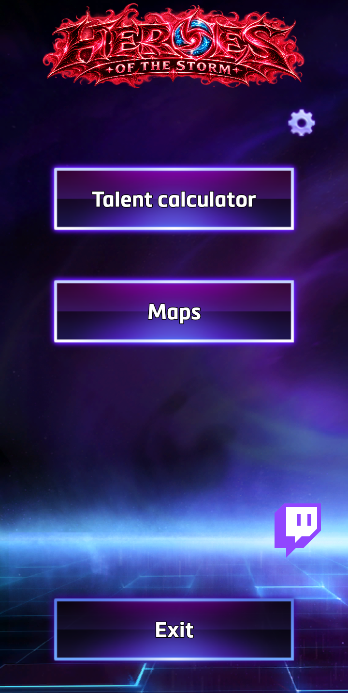
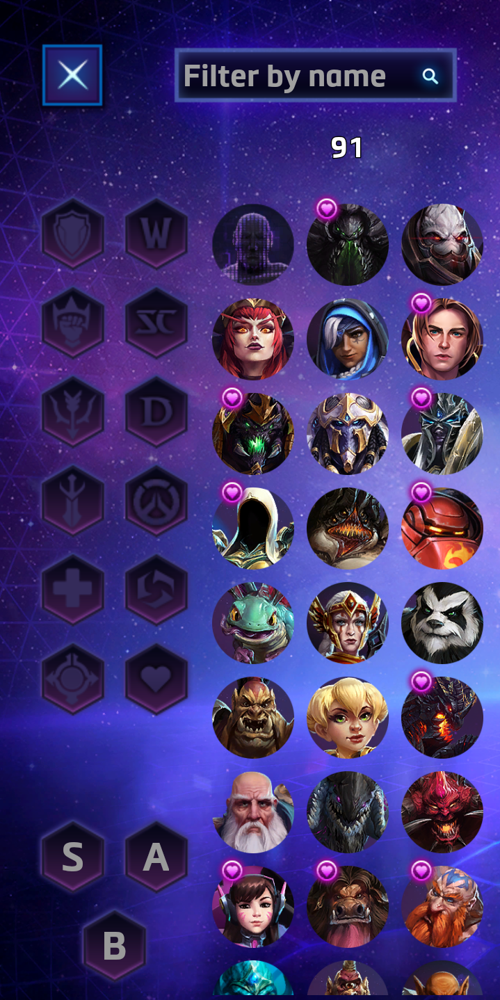
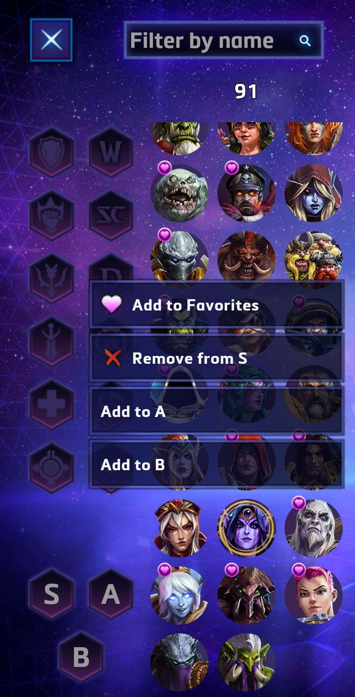
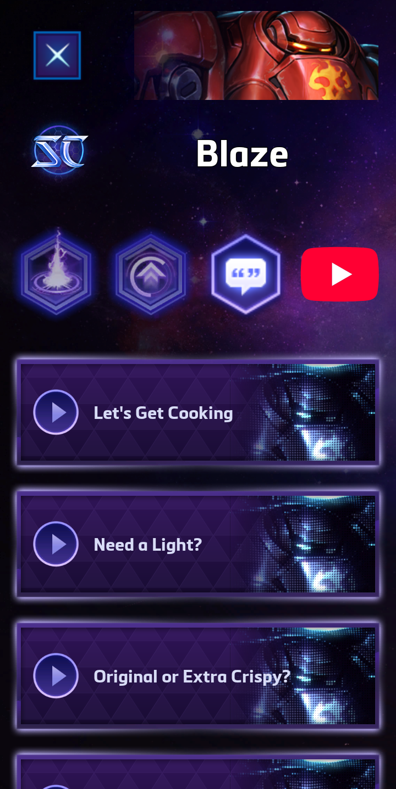
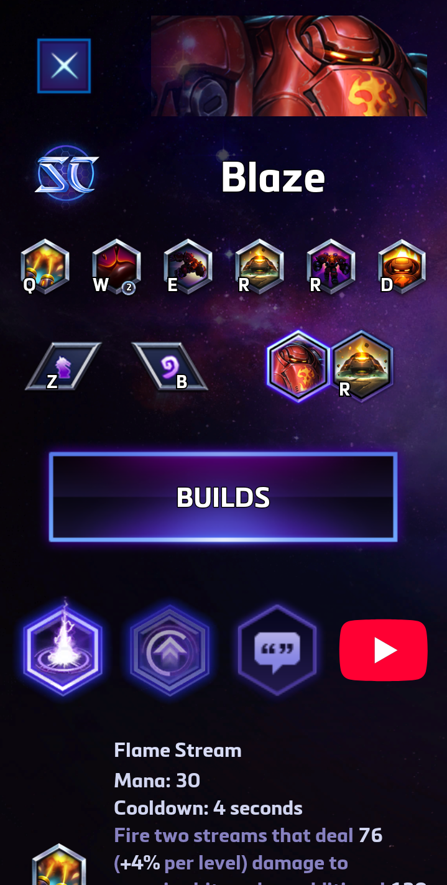
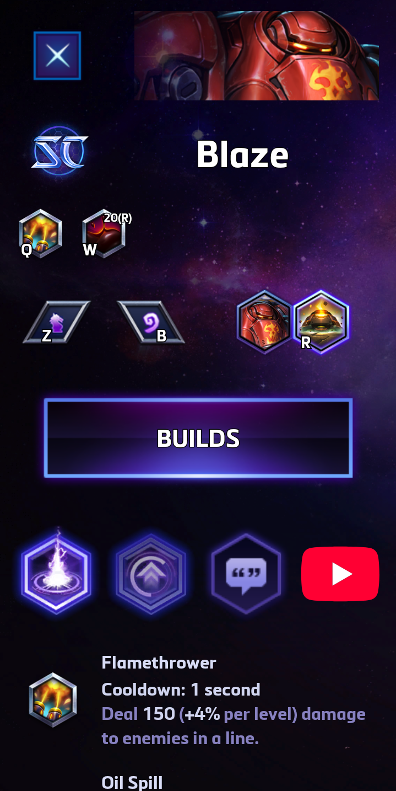
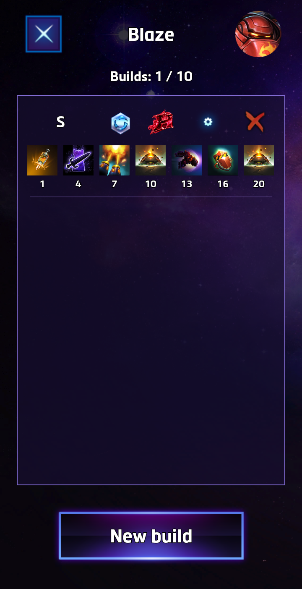
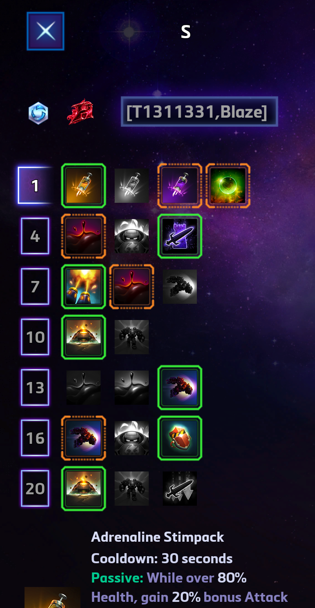

# HotS - Talent calculator

A fan-made Android talent calculator for Heroes of the Storm.

## Table of contents

- [Screenshots](#screenshots)
- [Features](#features)
- [Download and installation](#download-and-installation)
- [Credits and acknowledgments](#credits-and-acknowledgments)
- [Roadmap](#roadmap)
- [FAQ](#faq)
- [Build and verify](#build-and-verify)
- [Legal notices](#legal-notices)
- [License](#license)

## Screenshots

<table>
  <tr>
    <td></td>
    <td></td>
    <td></td>
    <td></td>
  </tr>
  <tr>
    <td></td>
    <td></td>
    <td></td>
    <td></td>
  </tr>
</table>

## Features

Browse heroes, explore talents and create builds offline. Your builds, favorites and personal filters are saved locally.

- **Hero browser:** search by name and combine role, universe, favorites and personal filters.
- **Favorites and personal filters:** bookmark heroes and organize them into up to four personal groups with customizable labels.
- **Random hero selection:** pick a random hero from the currently filtered list.
- **Abilities and talents:** view descriptions, charge indicators and alternate ability kits for heroes with multiple forms.
- **Hero voice lines:** listen to each hero's base voice lines directly within the app. Skin-specific voice lines are not included.
- **Build editor:** create, rename and delete up to 10 builds per hero, selecting one preferred talent and optional alternatives at each tier.
- **Build codes:** copy and import builds using the game's official syntax, or use the app's extended syntax to include alternative talents.
- **Import/export data:** back up and transfer your favorites, personal filters and builds using a JSON file, including hidden filters and alternative talent selections. Importing replaces the app's current saved data after confirmation.
- **Map information:** browse ARAM, Quick Match and Ranked maps, with details about objectives, mercenary camps, healing fountains and spawn/respawn timers.
- **YouTube and Twitch shortcuts:** open official hero spotlights where available, or browse Heroes of the Storm streams on Twitch.

## Download and installation

### Requirements

Requires Android 10 or later.

### Download

<a href="https://github.com/ceav17/HotS-Talent_calculator/releases/latest/download/HotS-Talent_calculator.apk">
  
</a>

## Credits and acknowledgments

Thanks to Johanna Faries, James Yen and the entire Heroes of the Storm team, as well as Blizzard Entertainment, for bringing new content to the Nexus and continuing to support the game.

Additional thanks to:

- [HeroesDataParser](https://github.com/HeroesToolChest/HeroesDataParser) by [HeroesToolChest](https://github.com/HeroesToolChest), for providing the tool used to download and extract the game's assets.
- [Icy Veins](https://www.icy-veins.com/heroes/talent-calculator), for some of the Heroes of the Storm information used in this app.

## Roadmap

Alongside bug fixes, I plan to add these features and improvements in future releases:

- A new main menu entry for the latest patch notes.
- Leaderboards sourced from Blizzard's website (internet connection required).
- The current free hero rotation (internet connection required).

## FAQ

### 1 - Will there be an iOS version?

Probably not. I'm not interested in developing for Apple's closed ecosystem, and I don't own any recent Apple devices, which would make testing difficult. Publishing on the App Store would also require an [Apple Developer Program membership](https://developer.apple.com/programs/enroll/), currently US$99 per year or the local equivalent.

### 2 - Will the app be available on Google Play?

Not for now. I'm concerned that Google is moving Android toward a more restricted ecosystem, closer to Apple's approach. See [Keep Android Open](https://keepandroidopen.org/) for more about these concerns.

I plan to reconsider in 2027, depending on how Google's changes are implemented and whether the rollout schedule changes again.

### 3 - Are the app's name and visual design final?

Not necessarily. There are a few things I'm not happy with and would like to revisit:

- **AI-generated artwork:** the custom main menu logo and app icon were generated in about five minutes, and I'm not satisfied with the results. I haven't had much success using AI for this kind of artwork, but I may try again when I can spend more time on it.
- **App name:** I couldn't think of a name that both made sense and appealed to me, so I chose a fairly generic one. It'll stay until I find something I like better.
- **Visual design:** I'd like to revisit some of the ways I've used and combined the game's assets throughout the interface.

## Build and verify

### Requirements

The verification workflow has been tested on Arch Linux. Other Linux distributions should work with the same tools and compatible command-line options.

Required tools:

- Bash 4 or newer.
- `dirname`, `realpath`, `mktemp`, `rsync`, `tail`, `tee`, `mkdir` and `uname`, with GNU-compatible options where applicable.
- Python 3.9 or newer, with the `apksigcopier` module.
- JDK 25, including both `java` and `javac`.
- Android SDK Platform API 37.
- Android SDK Build Tools 36.0.0, including `apksigner`, `aapt2` and `zipalign`.

Use the Gradle wrapper included in the repository. A separate Gradle installation is not required. Android Studio is optional.

An internet connection is needed for the first build to download the Gradle distribution and project dependencies.

**Windows and macOS:** Android build tools are available for both platforms, but the provided verification script currently supports Linux only. Native ports would need adjustments to platform checks, shell commands, paths and executable names, followed by reproducibility testing. Installing the corresponding Android tools alone is not sufficient to run this script unchanged.

I cannot currently test native Windows or macOS workflows, so no scripts for those platforms are provided. A frontier LLM may help adapt the scripts, but any resulting port still needs to be reviewed and tested.

Windows users may try running the Linux workflow inside WSL2, using Linux versions of the JDK, Android SDK and other dependencies. This configuration has not been tested for this project.

### Build from source and verify APK reproducibility

Download the signed APK and the matching **Source code (zip)** or
**Source code (tar.gz)** archive from the same
[release](https://github.com/ceav17/HotS-Talent_calculator/releases).

Extract the source archive and open a terminal in the extracted project
directory, where `verify-reproducibility.sh` is located.

Keep the release sources and dependency versions unchanged. The verification script uses both `verify-reproducibility.sh` in the repository root and `tools/verify_apk_reproducibility.py`.

If `apksigcopier` is not already available, you can install it in a dedicated Python environment outside the repository:

```bash
python3 -m venv "$HOME/.venvs/hots-reproducibility"

export HOTS_VERIFY_PYTHON="$HOME/.venvs/hots-reproducibility/bin/python"

"$HOTS_VERIFY_PYTHON" -m pip install apksigcopier
```

Set the paths to your installed JDK and Android SDK, replacing these examples with your actual paths:

```bash
export HOTS_JAVA_HOME="/absolute/path/to/jdk-25"
export HOTS_ANDROID_SDK="/absolute/path/to/android-sdk"
```

From the repository root, run:

```bash
chmod +x gradlew verify-reproducibility.sh

./verify-reproducibility.sh "/absolute/path/to/signed-release.apk"
```

The script:

1. Checks the required tools, the reference APK's signature and its application ID/version code.
2. Builds an unsigned release APK from a fresh copy of the sources, without reusing build outputs or Gradle build caches.
3. Transfers the published APK's existing signature data to the rebuilt APK.
4. Verifies the reconstructed APK's signature and requires a byte-for-byte match with the published APK.

A successful verification ends with:

```text
PASS: fresh rebuild, valid signature, and byte-for-byte identical signed APKs.
```

Results are saved in a new directory under:

```text
build/reproducibility/
```

The directory contains the rebuilt sources, build and verification logs, `reproduced.apk`, `report.json` and `SHA256SUMS`.

To check the environment and reference APK without compiling, use:

```bash
./verify-reproducibility.sh --check-env "/absolute/path/to/signed-release.apk"
```

Once the Gradle distribution and all required dependencies are cached, and the JDK and SDK components are installed, you can add `--offline`:

```bash
./verify-reproducibility.sh --offline "/absolute/path/to/signed-release.apk"
```

For additional options, run:

```bash
./verify-reproducibility.sh --help
```

## Legal notices

This is an unofficial fan-made app for Heroes of the Storm™. It is not affiliated with or endorsed by Blizzard.

Heroes of the Storm is a trademark of Blizzard Entertainment, Inc. Original game artwork, audio and text belong to Blizzard and their respective rights holders.

The YouTube, Twitch and GitHub logos are used to link to their respective services, in accordance with their brand guidelines.

## License

The app's original source code is licensed under the [MIT License](https://github.com/ceav17/HotS-Talent_calculator/blob/main/LICENSE). Game assets and third-party logos are excluded; see [Legal notices](#legal-notices).
